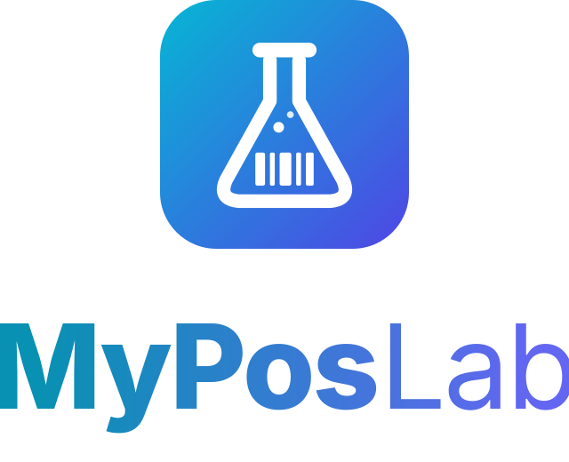

<p align="center">
  
</p>

# MyPosLab

MyPosLab is a modern, web-based point-of-sale system for retail shops, supermarkets, pharmacies, mobile and electronics stores, wholesalers, and takeaway outlets. It handles sales, inventory, customers, purchasing, accounting, reporting, and staff in one application that runs in any browser: PC, touchscreen terminal, tablet, or phone.

## Features

- Fast POS screen with barcode and weighing-scale barcode support
- Products, categories, units, taxes, and multiple price levels
- Inventory, stock adjustments, procurement from suppliers, low-stock alerts
- Customers, customer groups, credit accounts, loyalty rewards, and coupons
- Orders, payments, instalments, refunds, cash registers, and Z-reports
- Takeaway and delivery order types
- Sales, profit, stock, payment-type, and cash-flow reports
- Roles and permissions for owners, managers, and cashiers
- Light and dark themes, 15+ languages including Arabic (RTL)
- Module system for adding business-specific features

## Requirements

- PHP 8.2+ with `curl`, `gd`, `mbstring`, `pdo_mysql`, `zip`, `bcmath`, `intl`
- Composer 2
- MySQL 8 / MariaDB 10.6+ (or SQLite for testing)
- Node.js 24 (only needed to rebuild the frontend)

## Installation

```bash
git clone <your-repo-url> myposlab
cd myposlab
composer install
cp .env.example .env
php artisan key:generate
php artisan storage:link
npm install
npm run build
```

Point your web server's document root at `public/`, set `APP_URL` in `.env`, then open the site in a browser. The setup wizard will ask for the database details and create the administrator account.

For background jobs (reports, notifications, scheduled tasks) add the Laravel scheduler to cron:

```
* * * * * cd /path/to/myposlab && php artisan schedule:run >> /dev/null 2>&1
```

## Credits

MyPosLab is based on [NexoPOS](https://github.com/Blair2004/NexoPOS) by Blair2004 and its contributors. See [NOTICE](NOTICE) for details.

Some optional extensions (restaurant tables, multi-store, salon booking, etc.) are sold separately by the NexoPOS author on the [NexoPOS Marketplace](https://my.nexopos.com/en/marketplace). They are not part of this repository.

## License

MyPosLab is free software licensed under the [GNU General Public License v3.0](LICENSE), the same license as the original NexoPOS project.
