<p align="center">
  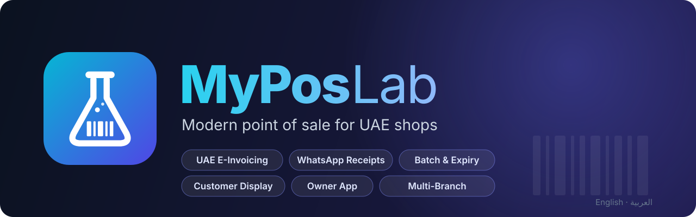
</p>

<p align="center">
  <a href="LICENSE"></a>
  
  
  
  
</p>

# MyPosLab

**MyPosLab is a web-based point of sale for shops in the UAE.** It runs in any browser — till PC, touchscreen terminal, tablet or phone — and covers selling, stock, purchasing, customers, accounting and reports. On top of the core POS it adds the things UAE shops ask for: **UAE e-invoicing, WhatsApp receipts, batch & expiry tracking, a customer-facing display, an owner app for the phone, and multiple branches.**

It suits supermarkets and groceries, pharmacies, mobile and electronics stores, clothing and cosmetics shops, hardware stores, wholesalers, and takeaway outlets.

<p align="center">
  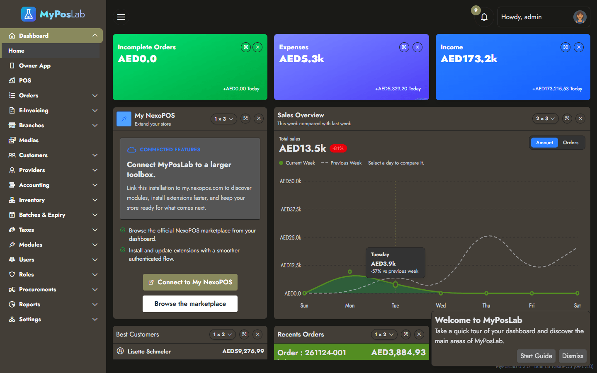
  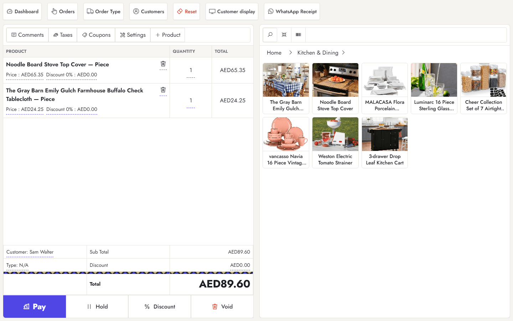
</p>

---

## Contents

- [Features](#features)
- [The six MyPosLab modules](#the-six-myposlab-modules)
- [Screenshots](#screenshots)
- [Requirements](#requirements)
- [Installation](#installation)
- [Configuration](#configuration)
- [Running the tests](#running-the-tests)
- [Project layout](#project-layout)
- [License](#license)

---

## Features

**Selling**
- Fast POS screen with search, categories, barcode scanner and weighing-scale barcodes
- Several units per product (piece, box, carton…) with their own prices
- Discounts, coupons, customer groups and loyalty rewards
- Cash, card and custom payment types, split and instalment payments, refunds
- Cash registers with opening/closing and Z-reports
- Takeaway and delivery order types

**Stock and purchasing**
- Products, categories, taxes (UAE VAT 5% ready) and unit groups
- Purchasing from suppliers (procurements) with automatic cost of goods sold
- Stock adjustments, stock history and low-stock alerts

**Customers, staff and reports**
- Customer accounts, credit, addresses and purchase history
- Roles and permissions for owner, manager and cashier
- Sales, profit, best products, payment types, cash flow, low stock and yearly reports
- Light and dark themes, 15+ languages including Arabic (right-to-left)

---

## The six MyPosLab modules

<p align="center">
  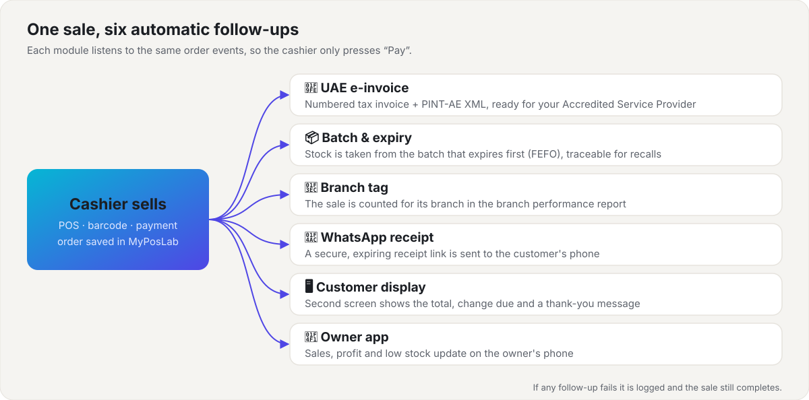
</p>

Each feature is a separate module under [`modules/`](modules), so a shop only switches on what it needs (**Dashboard → Modules**). A failure inside a module is logged and never blocks a sale.

### 🧾 UAE E-Invoicing — `modules/MplEInvoice`

The UAE is introducing mandatory e-invoicing (Ministerial Decisions 243 & 244 of 2025). Invoices are exchanged as **PINT-AE** (Peppol) XML through an **Accredited Service Provider (ASP)**. Large businesses (revenue ≥ AED 50M) go live on 1 January 2027; other businesses follow in 2027.

- Seller legal name in English and Arabic, 15-digit TRN, address and emirate in settings
- Buyer TRN and legal name on the customer form (new **Tax Details (UAE)** tab)
- Every paid order gets a gap-free invoice number: a **Tax Invoice** (buyer has a TRN) or a **Simplified Tax Invoice**; every refund gets a **Credit Note**
- PINT-AE UBL 2.1 XML generated for each document, with VAT per category (standard, zero-rated, exempt)
- Bilingual printable invoice (A4 and 80 mm)
- Send to your ASP over HTTPS with status tracking (submitted / accepted / rejected / failed), retry, and optional auto-submit

> MyPosLab produces the invoice data and hands it to your ASP. Before going live, validate the XML with the ASP you sign up with.

### 💬 WhatsApp Receipts — `modules/MplWhatsApp`

- **Send via WhatsApp** button after payment on the POS and on every order in the orders list
- **Free mode:** opens WhatsApp with the receipt message and a link, ready to send
- **Cloud API mode:** sends automatically through the Meta WhatsApp Business Cloud API using your approved template
- The link opens a mobile receipt page protected by a signed, expiring link. No login is needed, and no other order can be reached.
- UAE numbers are normalised (`050 123 4567`, `+971…`, `00971…` → `971501234567`), and a delivery log is kept
- Rate-limited so a cashier account cannot be used to spam numbers

### 📦 Batches & Expiry — `modules/MplBatches`

Built for pharmacies and groceries.

- Every stock delivery becomes a **batch** with batch number, expiry date and cost
- Sales take stock from the batch that expires first (**FEFO**); refunds return stock to the batch it came from
- Full trace of which batch went into which sale, for recalls
- Daily expiry alert, an **Expiry Report** (expired, ≤ 7 days, ≤ 30 days, value at cost) and an "Expiring soon" dashboard widget
- Optional blocking of expired stock at the till; write-off of expired batches

### 🖥️ Customer Display — `modules/MplCustomerDisplay`

- One click on the POS opens a second window for the customer-facing monitor
- Live cart lines, VAT, a large total, amount paid and change due, in English and Arabic
- "Thank you" screen after payment, then a welcome screen with clock and promotion slideshow
- Updates instantly through the browser, without any server round-trip

### 📱 Owner App — `modules/MplOwnerApp`

- Mobile dashboard for the owner: sales, gross profit, orders, average ticket, refunds, each compared with the previous period
- Sales by hour, payment methods, top products, low stock, open registers and latest orders
- Installable on the phone home screen (PWA). Scan the QR code from **Dashboard → Owner App**.
- Refreshes every minute; the last data stays readable offline and is cleared on sign-out

### 🏬 Branches — `modules/MplBranches`

- Create branches with address, TRN and receipt header/footer
- Assign staff and cash registers to branches; staff switch between their branches
- Every sale is tagged with its branch; branch column and filter on the orders list
- Branch details printed on receipts
- **Branch Performance** report: sales, orders, average ticket, gross profit and refunds per branch

> Version 1 shares one product catalogue and one stock across branches. Per-branch stock is planned.

---

## Screenshots

| | |
|---|---|
| 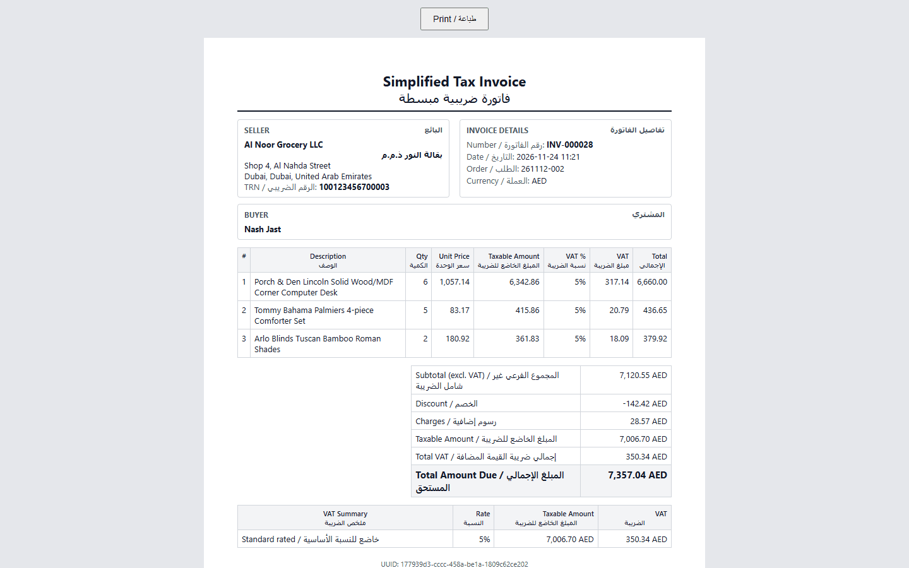<br>**Bilingual UAE tax invoice** | 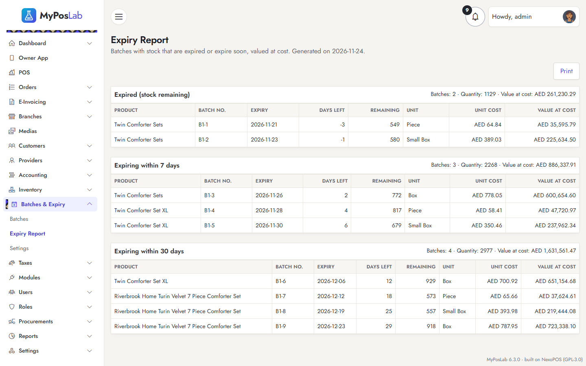<br>**Expiry report** |
| 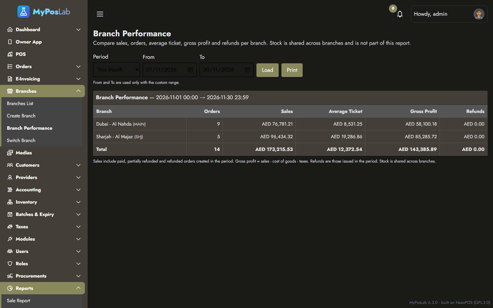<br>**Branch performance** | 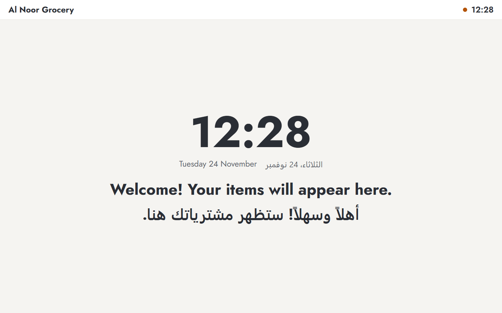<br>**Customer display** |
| 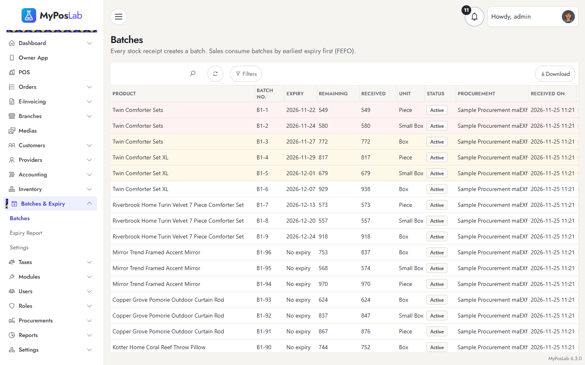<br>**Batches (expired in red, expiring soon in amber)** | 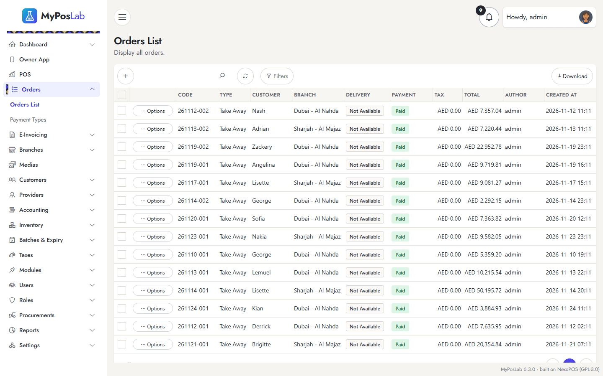<br>**Orders** |

<p align="center">
  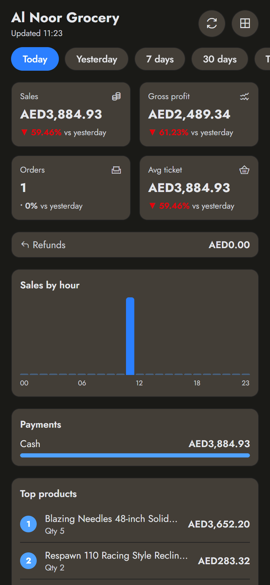
  &nbsp;&nbsp;
  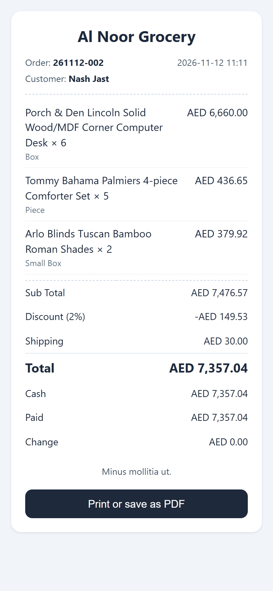
</p>
<p align="center"><b>Owner app</b> and <b>WhatsApp receipt page</b> on a phone</p>

---

## Requirements

| | Version |
|---|---|
| PHP | 8.2 or newer, with `bcmath`, `curl`, `fileinfo`, `gd`, `intl`, `mbstring`, `openssl`, `pdo_mysql`, `zip` |
| Composer | 2.x |
| Database | MySQL 8 or MariaDB 10.6+ (SQLite works for testing) |
| Node.js | 24 — only needed if you change the frontend |
| Web server | Apache or Nginx, document root set to `public/`; HTTPS recommended (required for the installable owner app) |

---

## Installation

```bash
git clone https://github.com/Ali-Razah/MyPosLab.git myposlab
cd myposlab

composer install --no-dev --optimize-autoloader
cp .env.example .env
php artisan key:generate
php artisan storage:link
```

The compiled frontend is already included in `public/build` and in each module's `Public/build`, so `npm` is optional.

1. Point the web server at `public/` and set `APP_URL` in `.env`.
2. Set `SANCTUM_STATEFUL_DOMAINS` and `SESSION_DOMAIN` to the domain you open MyPosLab on (for example `pos.myshop.ae`). If the dashboard says data "could not be loaded", this setting is the usual cause.
3. Open the site in a browser. The setup wizard asks for the database and creates the administrator account.
4. Enable the modules you want under **Dashboard → Modules**, or from the command line:

   ```bash
   php artisan modules:enable MplEInvoice
   php artisan modules:migrate MplEInvoice
   # same for MplWhatsApp, MplBatches, MplCustomerDisplay, MplOwnerApp, MplBranches
   ```

5. Add the scheduler to cron. Reports, expiry alerts and background jobs need it.

   ```
   * * * * * cd /path/to/myposlab && php artisan schedule:run >> /dev/null 2>&1
   ```

6. For production, run a queue worker (`php artisan queue:work`) so WhatsApp sending and e-invoice submission don't slow down the till.

### Try it with demo data

On a test installation you can load a sample grocery with products, purchases and sales:

```bash
php artisan ns:reset --mode=wipe_plus_grocery --with-sales --with-procurements
```

> ⚠️ This **erases all sales, products and customers** first. Never run it on a live shop.

---

## Configuration

Most settings are in the dashboard (**Settings**, and each module's own settings page). A few live in `.env`:

| Variable | Default | Purpose |
|---|---|---|
| `APP_URL` | — | Public address of the installation |
| `SANCTUM_STATEFUL_DOMAINS` | — | Domain(s) the dashboard is opened on |
| `NS_TELEMETRY` | `false` | When `true`, reports host name, version and enabled modules once a day to the upstream NexoPOS platform. Off by default in MyPosLab. |
| `NS_UPSTREAM_ADS` | `false` | When `true`, shows promotional banners from the upstream NexoPOS marketplace on the dashboard. Off by default in MyPosLab. |

---

## Running the tests

```bash
# core test suites (SQLite)
php artisan test --testsuite=Sequential-1
php artisan test --testsuite=Parallel-1,Sequential-2

# a module's tests (each module has its own phpunit.xml and isolated SQLite database)
cp tests/database.sqlite modules/MplEInvoice/Tests/test.sqlite
vendor/bin/phpunit --configuration modules/MplEInvoice/phpunit.xml
```

---

## Project layout

```
app/                 Laravel application (core POS)
resources/ts         Vue 3 + TypeScript frontend (dashboard and POS)
resources/views      Blade layouts and pages
modules/Mpl*         The six MyPosLab modules (each with Tests/ and phpunit.xml)
lang/                Translations (en, ar, fr, …)
public/build         Compiled frontend
docs/images          README images
```

---

## License

MyPosLab is based on [NexoPOS](https://github.com/Blair2004/NexoPOS) by Blair2004 (see [NOTICE](NOTICE)) and is licensed under the [GNU GPL v3.0](LICENSE).
